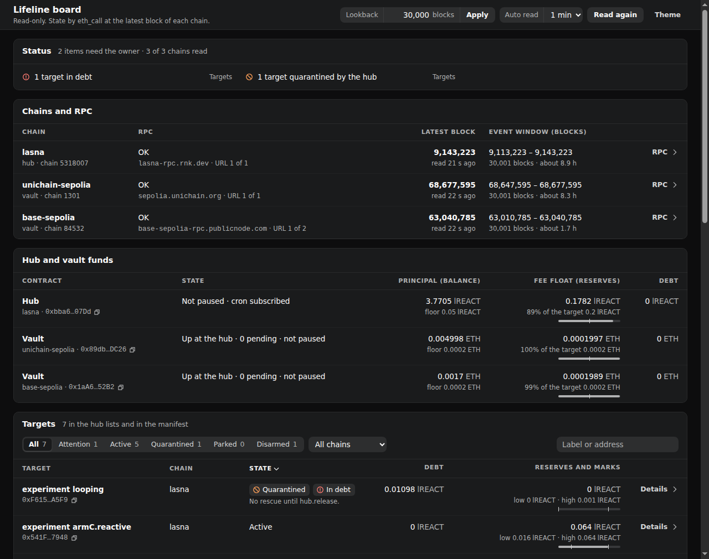
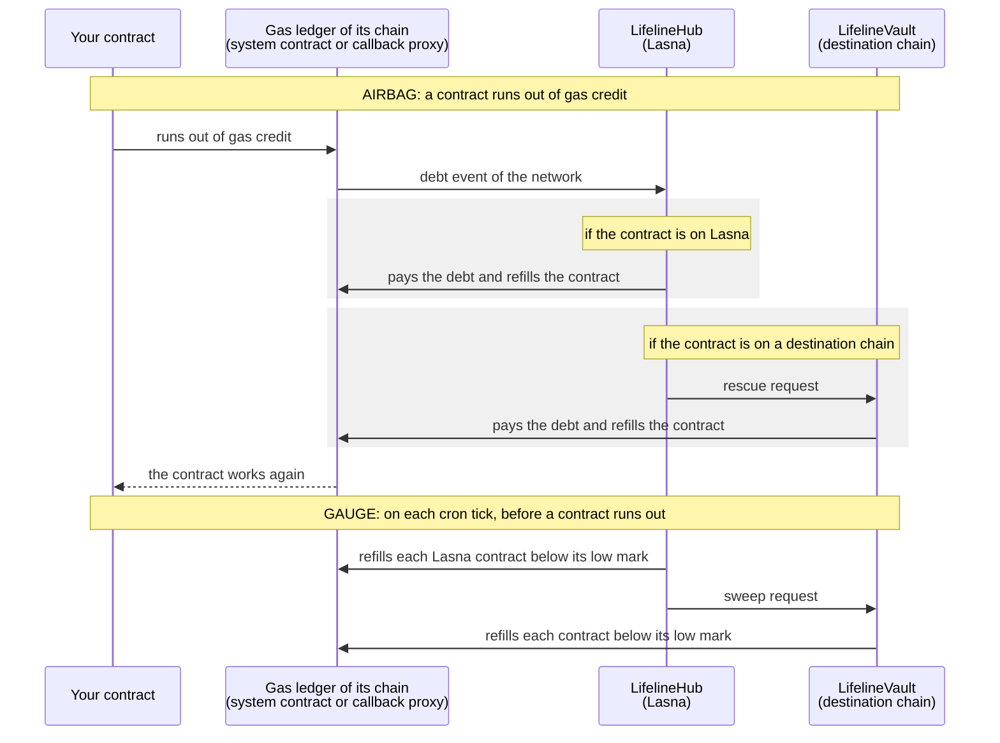

# lifeline | [](https://gekomarchi.github.io/lifeline/board/) [](JUDGE.md) [](LICENSE)

**Lifeline: the gas guardian for my reactive automations.** Reactive automations stop without a warning when their gas credit runs out. Lifeline is the guardian I set once: it refuels them across chains inside my budget, and it stops feeding one that breaks.

Reactive Omni Buildathon, track "Set It and Forget It". Testnet only. Each number in this file is a link to its query result or to [`JUDGE.md`](JUDGE.md), which is generated from chain data.
<!-- DEMO VIDEO: put the link in the line above when the video is ready. -->

## Problem

A reactive contract pays each run from its reserves at the gas ledger of its chain. When the reserves are empty, the contract gets no more work, and there is no error.

- **In this buildathon:** [22 of 75](evidence/network/table.md) submissions have a Lasna contract in debt (query `buildathon_debt`, Lasna block [9140577](evidence/network/table.md); a contract that a repository names can be an old deployment).
- **On the network since 2026-11-05:** [424](evidence/network/table.md) debt events on Lasna and [66](evidence/network/table.md) on the destination chains. [231 of 306](evidence/network/table.md) Lasna contracts that ran out are still in debt, and [19](evidence/network/table.md) ran out 3 times or more. About [159](evidence/network/table.md) callbacks were dropped (derived from debt intervals, not from observed reverts). The counts include the test canaries of this repository.
- **The builder's own automation:** `FastfillReactive` holds [60.37 lREACT](evidence/network/table.md) in reserves that cannot be withdrawn, because over-funding was the only protection.

## Proof

One rescue on Base Sepolia, from the origin event to the callback. Nobody sent a transaction after step 1: the network ran steps 2 and 3. The contract was alive again [1 s](JUDGE.md#rescue-latency) after the debt event ([5 blocks](JUDGE.md#rescue-latency)).

| Step | Chain | Transaction |
|---|---|---|
| 1. The callback contract runs out: the callback proxy emits `BlacklistContract(target)` | Base Sepolia | [`0x9bb5e827…5727`](https://base-sepolia.blockscout.com/tx/0x9bb5e827d134906e1ec5f184cd2fecd4a0370974fb8711d2baaabedcb0c15727) |
| 2. `LifelineHub.react()` sees the debt event and requests a rescue (`Relayed`) | Lasna | [`0x33cc6420…061e`](https://lasna.reactscan.net/tx/0x33cc6420f62ea2653c5fe28ae6b41d572a06405d10fdbc43fa2c9244fc35061e) |
| 3. Callback: `LifelineVault` pays the debt and refills (`Result: Rescued`, `WhitelistContract`) | Base Sepolia | [`0xd19743a0…1adf`](https://base-sepolia.blockscout.com/tx/0xd19743a00790ed97d97e0a4d830759dbf1293d2257fd61eb0f56f47b25091adf) |

A reactive contract on Lasna needs no callback: the hub pays in its own reaction, [1 block](JUDGE.md#rescue-latency) after the debt event ([`0xeb5f7b5f…b955`](https://lasna.reactscan.net/tx/0xeb5f7b5f092550dc46bb9eee726ac6d0c9bcf0999510209cd32dafb48cb6b955)). Every rescue, with its blocks and hashes, is in [`JUDGE.md`](JUDGE.md#destination-rescues).

| Measured on testnet | Result |
|---|---|
| Time from the debt event to the rescue, Lasna | [5 rescues](JUDGE.md#rescue-latency): median [1 s](JUDGE.md#rescue-latency), largest [1 s](JUDGE.md#rescue-latency) |
| Time from the debt event to the rescue, Base Sepolia | [6 rescues](JUDGE.md#rescue-latency): median [1 s](JUDGE.md#rescue-latency), largest [1 s](JUDGE.md#rescue-latency) |
| A canary that reverts in a loop | [Quarantined after 2 rescues](JUDGE.md#quarantine); the hub paid [0 after the quarantine](JUDGE.md#quarantine) |
| A flood of [556 junk callbacks](JUDGE.md#junk-flood) pushed the Base Sepolia vault offline | It took the fee float and [0.000122 ETH](JUDGE.md#junk-flood) of self-care, and no other principal ([0 unexplained](JUDGE.md#junk-flood)). [One deposit brought the vault back, and the hub repeated the waiting rescue](JUDGE.md#junk-recovery) |
| Tests | 193 Solidity tests on forks of the real ledgers (`forge test`); 217 Python tests of the real commands (`python -m pytest`) |

**Check it yourself.** Open the [live board](https://gekomarchi.github.io/lifeline/board/): it needs no install and reads the three chains in your browser. Or ask the ledger of Lasna for the debt of the hub with Foundry (`0` is the expected answer):

```
cast call 0x8888888888888888888888888888888888888888 "debt(address)(uint256)" 0xbba61E507e7CC334e57A62c39A776272DA6b07Dd --rpc-url https://lasna-rpc.rnk.dev/
```

[](https://gekomarchi.github.io/lifeline/board/)

| Contract | Chain | Address (explorer) | Verified source |
|---|---|---|---|
| `LifelineHub` | Lasna | [`0xbba61E507e7CC334e57A62c39A776272DA6b07Dd`](https://lasna.reactscan.net/address/0xbba61E507e7CC334e57A62c39A776272DA6b07Dd) | [Sourcify](https://repo.sourcify.dev/5318007/0xbba61E507e7CC334e57A62c39A776272DA6b07Dd) |
| `LifelineVault` | Unichain Sepolia | [`0x89dbc693c78C8844b5A3294DE8f7c0f0adf1DC26`](https://unichain-sepolia.blockscout.com/address/0x89dbc693c78C8844b5A3294DE8f7c0f0adf1DC26) | [Sourcify](https://repo.sourcify.dev/1301/0x89dbc693c78C8844b5A3294DE8f7c0f0adf1DC26) |
| `LifelineVault` | Base Sepolia | [`0x1aA62Eaf6746Ffc7a19330dD255211680B4952B2`](https://base-sepolia.blockscout.com/address/0x1aA62Eaf6746Ffc7a19330dD255211680B4952B2) | [Sourcify](https://repo.sourcify.dev/84532/0x1aA62Eaf6746Ffc7a19330dD255211680B4952B2) |

## How it works



- **Airbag.** The hub subscribes to the network's own debt event of each enrolled target, so it works when the application is dead. The payment is `debt + (high - reserves)`.
- **Gauge.** On each cron tick (`Cron10000` by default), each target with reserves below `low` is refilled to `high`. An automation normally does not run out.
- **Quarantine.** After `maxRescues` rescues inside `window` seconds, the next debt quarantines the target: a broken automation gets no more payment.
- **Funds.** The principal pays the targets, and the owner can withdraw it. Fees come only from a small fee float: neither contract has `pay()`.
- One hub on Lasna, one vault on each destination chain. No server, no bridge, no code in the target.

## Lifeline against the alternatives

Three identical canary automations got the same load at the same time: A has no guardian, B has a cron poller that calls `depositTo`, C is enrolled in Lifeline.

| | A: no guardian | B: cron poller | C: Lifeline |
|---|---|---|---|
| Trigger events sent | [24](JUDGE.md#three-arm-table) | [24](JUDGE.md#three-arm-table) | [24](JUDGE.md#three-arm-table) |
| Reactions that ran on Lasna | [7](JUDGE.md#three-arm-table) | [7](JUDGE.md#three-arm-table) | [24](JUDGE.md#three-arm-table) |
| Callbacks delivered on Base Sepolia | [3](JUDGE.md#three-arm-table) | [3](JUDGE.md#three-arm-table) | [24](JUDGE.md#three-arm-table) |
| Blocks of downtime on Lasna | [9891](JUDGE.md#three-arm-table) | [6978](JUDGE.md#three-arm-table) | [3](JUDGE.md#three-arm-table) |
| Blocks of downtime on Base Sepolia | [58884](JUDGE.md#three-arm-table) | [58841](JUDGE.md#three-arm-table) | [20](JUDGE.md#three-arm-table) |

- **A** stopped at its first debt and stayed dead to the end.
- **B** was dead on Lasna for [7369 s](evidence/network/table.md) (query `cron_poller_ward_dead_time`), until the next cron tick. Its callback contract stayed dead: this poller pays only on Lasna.
- **C** missed nothing. Each debt ended [1 s](JUDGE.md#rescue-latency) later. The [169 blocks](JUDGE.md#three-arm-table) of vault downtime in the full table are the junk flood test, which ran after the load.

Heights, definitions and costs: [the three-arm table](JUDGE.md#three-arm-table).

**Lifeline is not a wallet refiller.** A wallet refiller sends native currency to an account. Lifeline pays the debt of a contract at the gas ledger of Reactive Network: a stopped contract starts again only when that debt is paid.

| | Lifeline | Against Reactivate | Pitstop, a wallet refiller |
|---|---|---|---|
| What it refills | Reserves of reactive and callback contracts at the gas ledger, with `depositTo` | - | Native balance of wallets, with a transfer |
| Trigger | The network's own debt event, so the guardian works when the application is dead | New | A cron tick; each tank compares the balance with a floor |
| Restarts a stopped reactive contract | Yes | - | No: its source has no `depositTo` and no debt event |
| Code in the target | None: `depositTo` needs no code in the target | New | None |
| Infrastructure | No server and no deployment for each application | New | No server |
| Debt on a destination chain | Handled by the vault of that chain | New | Not handled |
| Budget | `maxDebt` and `dailyCap` in native units | New | A count of refills for each day |
| A target that breaks | Quarantine of that one target | New | A freeze stops the refills of every wallet of the tank |
| Principal isolation | The ledger can take only the fee float | New | A fee reserve that top-ups do not touch |
| Threshold top-up | The gauge | Not new | Yes |

Reactivate is an earlier project for the same problem. Pitstop is another submission of this buildathon, with a similar pitch and a different job: its column is from its public source at commit [`e06f79e`](https://github.com/0xvikram/pitstop/tree/e06f79e9bd6bce4e91b22718d99d773831e0bcc9). The two can run together. The strongest alternative to Lifeline is the cron poller of arm B, or large pre-funding.

## Quick start

You need `git`, Python 3.10 or later, and [Foundry](https://getfoundry.sh) (`forge`, `anvil`, `cast`).

```
git clone --recurse-submodules https://github.com/gekomarchi/lifeline
cd lifeline
python3 -m venv .venv && . .venv/bin/activate
pip install -e ".[ops]"
forge build
```

<details>
<summary><b>Fork dry run</b>: no funds, ends with <code>loop-check passed</code></summary>

Start three local forks, each in its own terminal:

```
anvil --fork-url https://lasna-rpc.rnk.dev/ --port 8545 --disable-min-priority-fee
anvil --fork-url https://unichain-sepolia.drpc.org --fork-block-number 68574000 --port 8546 --disable-min-priority-fee
anvil --fork-url https://base-sepolia.gateway.tenderly.co --fork-block-number 62527000 --port 8547 --disable-min-priority-fee
```

In a fourth terminal, in the repository with the virtual environment active:

```
cast rpc anvil_mine 0x1 --rpc-url http://127.0.0.1:8545
cast wallet new        # a throwaway key: it prints an address and a private key
export LIFELINE_OWNER_KEY=<the private key>
for port in 8545 8546 8547; do cast rpc anvil_setBalance <the address> 0x56BC75E2D63100000 --rpc-url http://127.0.0.1:$port; done

DRY=(--manifest .cache/dry/manifest.json --rpc lasna=http://127.0.0.1:8545 --rpc unichain-sepolia=http://127.0.0.1:8546 --rpc base-sepolia=http://127.0.0.1:8547)
python -m lifeline.ops deploy "${DRY[@]}"
python -m lifeline.forkrelay "${DRY[@]}" --state .cache/dry/relay.json --watch &
python -m lifeline.ops loop-check --chain base-sepolia --canary-reserve 0.05 "${DRY[@]}"
python -m lifeline.ops status "${DRY[@]}"
```

`loop-check` deploys a test target (a canary pair), enrolls it, puts it into debt and waits for the rescue. The target is protected when the output ends like this:

```
  1 proxy debt event BlacklistContract(canary) on base-sepolia: tx 0x… block …
  2 Lasna reaction with Relayed: tx 0x… block …, requestId …
  3 vault Result on base-sepolia: tx 0x… block …, requestId …, outcome Rescued, paid …
  4 debt(canary) at the proxy of base-sepolia: 0 at block …
loop-check passed
```

`status` then shows the canary with `hub state Active, debt 0`.

- The forks run the real system contract and the real callback proxies. `forkrelay` emulates only the node. A dry run does not prove real delivery or latency.
- The RPC of a destination fork must serve the state of the fork block. At the two blocks above, the proxies authorize the delivery account that `forkrelay` uses. For another block, give `--operator <chain>=<address>`.
- For a new dry run, start new forks and delete `.cache/dry`.

</details>

<details>
<summary><b>Testnet</b>: the same steps with a funded key</summary>

Use a funded key. `deploy` prints its checks first, and it sends nothing if the balance of a chain is not above `principal + feeFloat` of the contracts of that chain in [`deployments/config.json`](deployments/config.json).

```
export LIFELINE_OWNER_KEY=<a funded key>
python -m lifeline.ops deploy --manifest deployments/my-manifest.json
python -m lifeline.ops loop-check --chain base-sepolia --manifest deployments/my-manifest.json
python -m lifeline.ops status --manifest deployments/my-manifest.json
```

`deployments/manifest.json` is the deployment of the builder, and only its owner key can use it. With that key, do not run `deploy`, and omit `--manifest`.

The end is the same as in the dry run. The canary stays enrolled: remove it with `remove`, or continue with your own contract in "Enroll".

</details>

## Operator guide

Enroll one contract (example amounts, in the native unit of the chain; for a reactive contract use `--chain lasna` and amounts in lREACT):

```
python -m lifeline.ops enroll --chain unichain-sepolia --target <address> --label "my callback contract" \
  --low 0.0005 --high 0.002 --max-debt 0.001 --daily-cap 0.004 --max-rescues 2 --window 3600
```

Stop it with `python -m lifeline.ops remove --chain <name> --target <address>`. See the state with `python -m lifeline.ops status`.

<details>
<summary><b>All commands, policy flags, presets and recovery transactions</b></summary>

Each command accepts `--manifest <file>` (default [`deployments/manifest.json`](deployments/manifest.json)) and `--rpc <chain>=<url>`. Chain names: `lasna`, `unichain-sepolia`, `base-sepolia`. `LIFELINE_OWNER_KEY` is the key of the owner; `verify` and `status` need no key. After a failure, run the same command again: it continues. Do not run two commands with one key at the same time.

| Task | Command |
|---|---|
| Deploy the hub and the vaults from [`deployments/config.json`](deployments/config.json); write the manifest | `python -m lifeline.ops deploy` |
| Verify the contracts on Sourcify | `python -m lifeline.ops verify` |
| Enroll one target | `python -m lifeline.ops enroll` (see above) |
| Enroll each `fleet` entry of the configuration | `python -m lifeline.ops fleet` |
| Remove a target | `python -m lifeline.ops remove --chain <name> --target <address>` |
| Restore a vault that is in debt | `python -m lifeline.ops recover --chain <name>` |
| Show funds and states; a `WARN` line and exit status 1 for each item that needs the owner | `python -m lifeline.ops status` |
| Show the full rescue loop with a test target on a destination chain | `python -m lifeline.ops loop-check --chain <name>` |
| Build the read-only board [`board/index.html`](board/index.html) | `python -m lifeline.board` |

### Policy

| Flag | Meaning |
|---|---|
| `--low` | The refill mark. The gauge refills a target with reserves below it. |
| `--high` | The reserves after a payment. |
| `--max-debt` | A debt above this is not paid. There is never a partial payment. |
| `--daily-cap` | The most principal for this target in one calendar day (UTC). |
| `--max-rescues`, `--window` | A rescue is a payment that cleared a debt. After `--max-rescues` rescues (1 to 4) inside `--window` seconds, the next debt quarantines the target. |

- **Presets (advice, not measurements).** One run is the fee of one reaction or one callback of your target. light (a few runs each day): `low` 2 runs, `high` 10 runs. standard (each hour): 4 and 20. heavy (each minute): 10 and 50. The fleet policy of `FastfillReactive` has [`low` 0.05 lREACT and `high` 0.25 lREACT](JUDGE.md#fleet-report).
- **Order.** Lasna target: `hub.enroll`, which reconciles the target at once. Destination target: `vault.setPolicy` (the vault reconciles at once), a read-back of `vault.policyOf`, then `hub.enroll` on Lasna.
- If the `setPolicy` line shows `DebtAboveCap`, `DailyCap` or `Floor`, the vault paid nothing and an old debt stays: clear it or give another policy.

### Stop and recover

`remove` sends `hub.disarm(chainId, target)` first, then `vault.disarm(target)`. A Lasna target stops with `hub.disarm`. For a destination target, `vault.disarm` is the authoritative stop, and `hub.disarm` stops the relay cost.

| Case | Transaction |
|---|---|
| The hub is in debt, or `status` warns about its float | `depositTo(hub)` at the system contract on Lasna, with a value |
| A vault is in debt (the hub emits `VaultDown`) | `proxy.depositTo(vault)` with the debt plus a new float as the value, then `hub.vaultUp(chainId)` on Lasna when `debt(vault)` is 0. `recover` does both, and repeats `vaultUp` until no target is pending. |
| A destination target is parked by the relay limit (`RelayLimited`: `2 x maxRescues + 2` requests inside `window`) | `hub.rearm(chainId, target)` on Lasna |
| A target is quarantined | Lasna target: `hub.release(target)`. Destination target: `vault.release(target)` on the destination chain. |
| `status` warns about a low principal | A plain transfer of the native currency to the hub or to the vault. The owner takes principal back with `withdraw(uint256)`; a float cannot be withdrawn. |

Any account can send `depositTo`. The other functions accept only the owner. With `cast` (example value):

```
cast send <ledger> "depositTo(address)" <hub or vault> --value 0.2ether --rpc-url <RPC of the chain> --private-key $LIFELINE_OWNER_KEY
cast send <hub> "rearm(uint256,address)" <chainId> <target> --rpc-url <Lasna RPC> --private-key $LIFELINE_OWNER_KEY
```

</details>

## Limits

- **Future delivery, not zero loss.** Lifeline restores future delivery. Work that arrives while a target is in debt is lost. The owner learns what to retry from the `Gap` event of the hub (Lasna target) or from the debt interval at the callback proxy (destination target). `JUDGE.md` lists each gap.
- **Junk callbacks.** If someone floods a Lifeline vault with junk callbacks, the rescue funds are not spent on them: the proxy can take only the small fee float, and at most `selfCareDailyCap` of principal per day refills that float. The vault can be pushed offline. One transaction, `proxy.depositTo(vault)`, brings it back, and the hub then repeats the rescues that were waiting. The largest loss for each day is the float plus `selfCareDailyCap`. Full prevention needs a platform change.

<details>
<summary><b>Six more limits</b>: caps, events, sample values, sweep cost, <code>vaultUp</code>, low funds</summary>

- **Calendar-day caps.** Calendar-day caps allow two caps across midnight (UTC).
- **`PaymentFailure`.** `PaymentFailure` does not always accompany debt. Lifeline listens to `BlacklistContract` only.
- **Sample values.** [0.0125 lREACT and 7e11 wei](evidence/network/table.md) are samples (the `sampleFeeWei` parameters of the queries), not protocol constants.
- **A quarantined target in the sweep.** A target that is quarantined on a vault stays in the sweep of the hub until `hub.disarm`. The cost is bounded: one sweep for each vault for each tick while at least one target is enrolled on that chain, plus one storage read and one `Result` event for the quarantined target.
- **`vaultUp` only after the vault debt is 0.** The hub cannot read the destination ledger. A sweep request to a vault in debt is not delivered, and its targets are not pending any more.
- **Low funds.** `HubLow` and `VaultLow` come only when the principal is below `principalFloor`. A hub at its floor goes into debt with no event when its float is empty. `status` warns before that state.

</details>

## Not built

Public rescue pool; mutual-guard contract; adaptive cron speed; learned burn rate as a safety rule; quarantine from failure events; replay of work lost in the gap; movement of funds between vaults; automatic recovery of a vault that is in debt.

## Demo versus production

- **Demo:** testnet, one owner, fixed marks, no upgradeability, two destination chains at most.
- **Production:** audit; a rolling budget window; a price for destination gas; a platform answer to junk callbacks (admission control before the recipient is billed).

## Guests

The owner enrolls a contract of another participant on request, with the written consent of the target owner: `enroll --guest --consent <reference>`. Without the reference the command refuses. Status: [no guest enrolled](JUDGE.md#guests). The candidates are in the `guest_candidates` and `buildathon_debt` queries of [`evidence/network/data.json`](evidence/network/data.json).

## Evidence and reproduction

The three commands need no key and send no transaction. A first run pins the heights and writes `heights.json`. A run with `--heights <file>` gives the same files again.

| Evidence | Command | Output |
|---|---|---|
| Network statistics | `python -m lifeline.stats [--heights <file>]` | [`evidence/network/`](evidence/network/table.md) |
| Three-arm experiment | `python -m lifeline.experiment measure [--heights <file>]` | [`evidence/experiment/`](evidence/experiment/table.md) |
| Lifeline's own operation | `python -m lifeline.judge [--heights <file>]` | [`JUDGE.md`](JUDGE.md), [`evidence/judge/`](evidence/judge/data.json) |

<details>
<summary><b>Run order and experiment drivers</b></summary>

- `JUDGE.md` is generated: do not edit it. Run `measure` first, then `judge`.
- The experiment drivers send transactions: `python -m lifeline.experiment <driver>`, in this order: `fixtures`, `load --pokes <n> --interval <seconds>`, `quarantine`, `junk --chain <name>`. They need `LIFELINE_FIXTURE_KEY`; `fixtures` and `junk` also need `LIFELINE_OWNER_KEY`.

</details>

## Development

<details>
<summary><b>Build and test</b></summary>

Foundry 1.10.0, Solidity 0.8.30. Each node must serve the state of the fork blocks of the tests.

```
export LASNA_RPC_URL=<url> BASE_SEPOLIA_RPC_URL=<url>
forge test                                # the contracts against the real ledgers on forks
pip install -e ".[test]" && python -m pytest   # the real commands against a local JSON-RPC server
```

The fork modules (`test_*_forks.py`) repeat the dry run. They need `anvil`, the build output and `UNICHAIN_SEPOLIA_RPC_URL`; without one of them they are skipped. Set `BASE_SEPOLIA_FORK_BLOCK=62527000` and `UNICHAIN_SEPOLIA_FORK_BLOCK=68574000`.

</details>

## License

Apache License 2.0. See [`LICENSE`](LICENSE).
